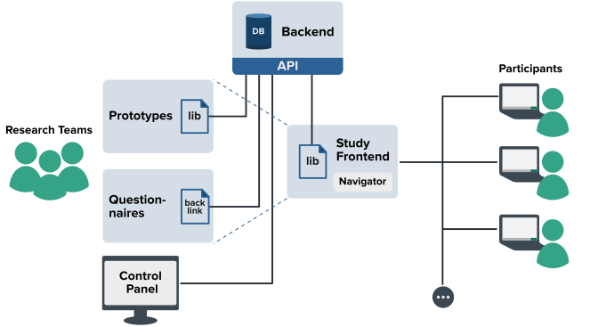

<div align="center">


**An open-source platform for building, running, and logging web-based HCI and human–AI user studies.**

[Documentation](docs/README.md) · [Deployment](DEPLOYMENT.md) · [Contributing](CONTRIBUTING.md) · [Paper (ACM DL)](https://dl.acm.org/doi/10.1145/3733053)

</div>

---

StudyAlign lets researchers set up online user studies to evaluate functional,
interactive web prototypes — including prototypes with AI features. It handles
the parts every web-based study re-implements: the experiment procedure,
counterbalancing, questionnaire integration, participant flow, and interaction
logging, so you can focus on the research instead of the plumbing.

It is described in our paper, *StudyAlign: A Software System for Conducting
Web-Based User Studies with Functional Interactive Prototypes*
([ACM DL](https://dl.acm.org/doi/10.1145/3733053); preprint:
[arXiv:2505.13046](https://arxiv.org/abs/2505.13046)). If you use it in your
research, please [cite it](#citation).

## Key features

- **Control panel for creating studies** — a setup wizard to design procedures
interactively and select parts for counterbalancing.
- **Participant frontend** — guides participants end to end and enforces that
they proceed one step at a time.
- **Prototype library** — drop `study-align-lib` into your prototype to log
browser events (mouse, keyboard, touch) and custom data objects as one-liners.
- **Interaction logging** — the backend persists native events and arbitrary
custom payloads.
- **External questionnaires** — embed surveys from your own LimeSurvey or
Qualtrics, configured per study.
- **Share &amp; reuse studies** — import/export study schemas to share as paper
material and evolve designs across projects.

## System overview



StudyAlign has four parts: a **backend** (the core — API + database), a
**control panel** for researchers, a **study frontend** for participants, and a
**client library** embedded in prototypes for logging. See the
[documentation](docs/README.md) for the full picture, study-design patterns, and
screenshots.

## Quick start (local dev)

Requires Docker and Docker Compose.

```bash
cp .env.example .env         # then edit: set SECRET_KEY, API_ADMIN_KEY, DB creds
docker compose up            # database + backend + both frontends

# initialise the database (first run only)
docker compose exec study_align_backend python /app/init_db.py
```

- Backend API and interactive docs: [http://localhost:8000/docs](http://localhost:8000/docs)
- Control panel (admin frontend): [http://localhost:3000](http://localhost:3000)
- Study frontend: [http://localhost:3366](http://localhost:3366)

The compose services are named `study_align_backend`,
`study_align_admin_frontend`, and `study_align_study_frontend`. For production
(behind Caddy), see [DEPLOYMENT.md](DEPLOYMENT.md).

## Repository layout

```
study-align/
├── apps/
│   ├── backend/            FastAPI + SQLAlchemy + Postgres API (app in backend/app)
│   ├── admin-frontend/     React control panel for designing and managing studies
│   └── study-frontend/     React participant UI that runs the study
├── libs/
│   └── study-align-lib/    TypeScript client library for interaction logging
├── docs/                   Documentation, study/questionnaire examples, and the
│                           app-examples submodule (demo prototypes)
├── docker-compose.yml      Dev stack for the whole system
├── docker-compose.prod.yml Production stack (served behind Caddy)
└── .env.example            Environment template (copy to .env)
```


| Component       | Stack                                                | Dev port               |
| --------------- | ---------------------------------------------------- | ---------------------- |
| backend         | FastAPI, SQLAlchemy, Alembic, Postgres               | 8000                   |
| admin-frontend  | React 19, Redux Toolkit, react-router 6, Bootstrap 5 | 3000                   |
| study-frontend  | React 19, Redux Toolkit, react-router 6, Bootstrap 5 | 3366                   |
| study-align-lib | TypeScript, webpack                                  | n/a (published to npm) |


## Surveys / questionnaires

Studies embed questionnaires from an **external** survey tool (LimeSurvey or
Qualtrics). StudyAlign does not bundle or host a survey instance — you point a
study at your own survey tool by entering its URL and API credentials per study
in the control panel. See [`docs/examples/README.md`](docs/examples/README.md)
for ready-to-import LimeSurvey `.lss` examples, and
[`docs/native-questionnaires.md`](docs/native-questionnaires.md) for StudyAlign's
built-in (native) questionnaires.

## Example prototypes (submodule)

Instrumented demo prototypes live in a submodule at `docs/app-examples`
([StudyAlign/app-examples](https://github.com/StudyAlign/app-examples)): a React
and a vanilla-JavaScript app, each wiring `study-align-lib` into a small editor.
Fetch it with:

```bash
git submodule update --init docs/app-examples
```

## Contributing

Contributions are welcome — see [CONTRIBUTING.md](CONTRIBUTING.md) for the dev
setup, conventions, and how to propose changes. To report a security issue,
please follow [SECURITY.md](SECURITY.md) rather than opening a public issue.

## Citation

If StudyAlign supports your research, please cite the paper. A machine-readable
entry is in [`CITATION.cff`](CITATION.cff) (GitHub shows a “Cite this
repository” button), or use:

```bibtex
@article{10.1145/3733053,
author = {Lehmann, Florian and Buschek, Daniel},
title = {StudyAlign: A Software System for Conducting Web-Based User Studies with Functional Interactive Prototypes},
year = {2025},
issue_date = {June 2025},
publisher = {Association for Computing Machinery},
address = {New York, NY, USA},
volume = {9},
number = {4},
url = {https://doi.org/10.1145/3733053},
doi = {10.1145/3733053},
abstract = {Interactive systems are commonly prototyped as web applications. This approach enables studies with functional prototypes on a large scale. However, setting up these studies can be complex due to implementing experiment procedures, integrating questionnaires, and data logging. To enable such user studies, we developed the software system StudyAlign which offers: 1) a frontend for participants, 2) an admin panel to manage studies, 3) the possibility to integrate questionnaires, 4) a JavaScript library to integrate data logging into prototypes, and 5) a backend server for persisting log data, and serving logical functions via an API to the different parts of the system. With our system, researchers can set up web-based experiments and focus on the design and development of interactions and prototypes. Furthermore, our systematic approach facilitates the replication of studies and reduces the required effort to execute web-based user studies. We conclude with reflections on using StudyAlign for conducting HCI studies online.},
journal = {Proc. ACM Hum.-Comput. Interact.},
month = jun,
articleno = {EICS007},
numpages = {26},
keywords = {software system, software framework, web-based experiments, evaluation, interactive prototypes, interactive AI, user studies}
}
```

## License

StudyAlign is released under multiple licenses, by component (see
[`LICENSE`](LICENSE) for the authoritative statement and each directory's own
`LICENSE` file for the full text):


| Component                               | License       |
| --------------------------------------- | ------------- |
| `libs/study-align-lib` (client library) | MIT           |
| `apps/backend`                          | AGPL-3.0-only |
| `apps/admin-frontend`                   | AGPL-3.0-only |
| `apps/study-frontend`                   | AGPL-3.0-only |


The platform as a whole (including top-level tooling, deployment config, and
docs) is **AGPL-3.0-only**; the client library is carved out as **MIT** so it
can be embedded freely in instrumented products and prototypes.

## Studies enabled by StudyAlign

StudyAlign has supported studies published at major HCI venues — see the full
list in the [documentation](docs/README.md#studies-enabled-by-studyalign).

## History

This repo was assembled from, and supersedes, these now-archived repositories:


| Archived repo                | Now at                 |
| ---------------------------- | ---------------------- |
| `study-align-backend`        | `apps/backend`         |
| `study-align-admin-frontend` | `apps/admin-frontend`  |
| `study-align-study-frontend` | `apps/study-frontend`  |
| `study-align-lib`            | `libs/study-align-lib` |
| `studyalign-docs`            | `docs`                 |


